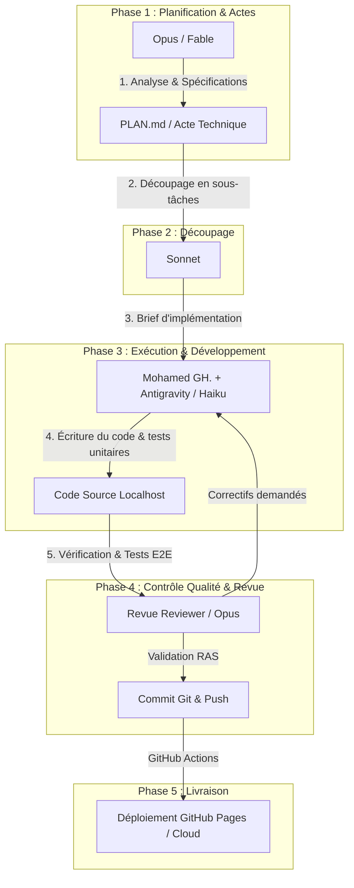
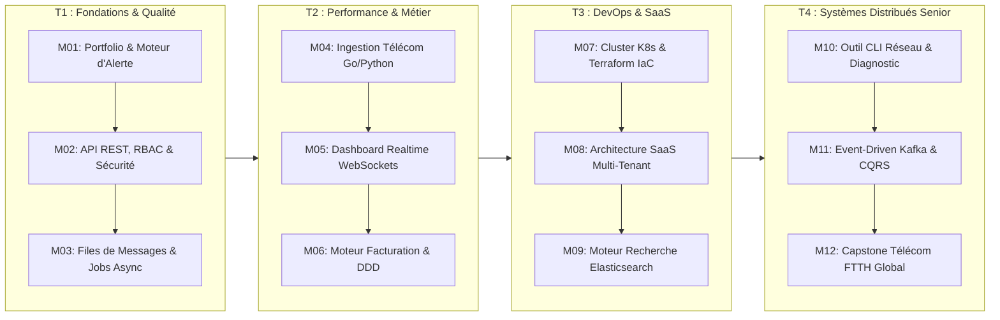
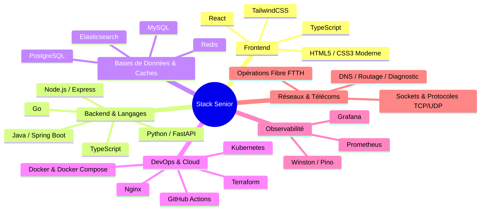

# Cartographie Globale du Projet — Programme Senior (12 Mois, 12 Projets)

> **Programme d'accélération technique : Du droit aux réseaux télécoms (FTTH), des réseaux au niveau de Développeur Full Stack Senior.**  
> Période officielle : **16 novembre 2026 – 15 novembre 2027**  
> Dépôt officiel : [github.com/mghamraoui4/mohamed-portfolio-projects](https://github.com/mghamraoui4/mohamed-portfolio-projects)  
> Site de suivi en direct : [mghamraoui4.github.io/mohamed-portfolio-projects](https://mghamraoui4.github.io/mohamed-portfolio-projects/)

---

## Sommaire

1. [Vision & Philosophie du Programme](#1-vision--philosophie-du-programme)
2. [Workflow de Collaboration Multi-Agents](#2-workflow-de-collaboration-multi-agents)
3. [Feuille de Route des 12 Projets (Roadmap 4x3)](#3-feuille-de-route-des-12-projets-roadmap-4x3)
4. [Matrice des Compétences Senior Ciblées](#4-matrice-des-compétences-senior-ciblées)
5. [Cartographie des Technologies & Outils](#5-cartographie-des-technologies--outils)
6. [Arborescence du Répertoire](#6-arborescence-du-répertoire)
7. [Cycle de Vie d'un Projet & Définition de Terminé (DoD)](#7-cycle-de-vie-dun-projet--définition-de-terminé-dod)
8. [Lancement Local & Déploiement](#8-lancement-local--déploiement)

---

## 1. Vision & Philosophie du Programme

Ce programme n'est pas une simple suite de tutoriels, mais un **banc d'essai d'ingénierie logicielle** conçu pour prouver et valider le passage au niveau **Senior**.

Il s'appuie sur une triple identité :
* **La rigueur du juriste** : Clarté des spécifications, respect absolu des contrats d'interface, traçabilité et documentation opposable.
* **Le pragmatisme du technicien réseaux FTTH** : Connaissance du terrain, tolérance aux pannes, contraintes d'infrastructure et passage à l'échelle.
* **L'exigence du développeur senior** : Architecture modulaire, automatisation CI/CD, sécurité par défaut (Security by Design), observabilité et haute disponibilité.

### L'Engagement Contractuel (Les 5 Articles)

```
┌─────────────────────────────────────────────────────────────────────────────┐
│                            CONTRAT D'ENGAGEMENT PUBLIC                      │
│                                                                             │
│  Art. 1 : Un projet par mois (12 projets du 16/11/2026 au 15/11/2027).      │
│  Art. 2 : Terminé veut dire terminé (testé, déployé, documenté, annoncé).   │
│  Art. 3 : Tout est public (code sur GitHub avec accès transparent).          │
│  Art. 4 : J'écris le code moi-même (assisté, relu, mais jamais remplacé).   │
│  Art. 5 : Les retards s'affichent automatiquement en rouge sur le tracker.  │
│                                                                             │
│  Fait à Casablanca, le 16 novembre 2026 — Mohamed GH.                      │
└─────────────────────────────────────────────────────────────────────────────┘
```

---

## 2. Workflow de Collaboration Multi-Agents

Pour maximiser l'apprentissage sans jamais déléguer la compréhension du code, une chaîne de production à rôles stricts est établie :



### Répartition des Responsabilités

| Intervenant | Rôle Principal | Responsabilité concrète |
|---|---|---|
| **Mohamed GH.** | **Auteur & Pilote** | Écrit le code, valide les choix d'architecture, apprend et teste en localhost. |
| **Claude Opus / Fable** | **Architecte & Juriste** | Rédaction des actes de projet, formalisation de `PLAN.md`, relecture finale et validation critique. |
| **Claude Sonnet** | **Coordinateur** | Découpage des grandes étapes en sous-tâches atomiques (1 à 3 fichiers max). |
| **Antigravity / Haiku** | **Exécuteurs Techniques** | Support d'implémentation, scaffolding, configuration tooling, scripts d'automatisation, UI/UX. |

---

## 3. Feuille de Route des 12 Projets (Roadmap 4x3)

Les 12 projets sont ordonnés **du plus simple au plus difficile** et répartis en 4 grands trimestres d'apprentissage :



### Tableau Détaillé des 12 Jalons

| Mois | Période | Intitulé du Projet | Niveau | Technologies Clés | Compétence Senior Validée |
|:---:|:---:|---|:---:|---|---|
| **01** | 16/11/26 – 15/12/26 | **Portfolio & Moteur de Suivi** | Niv. 1/5 | HTML5, CSS3, JS Vanilla, GitHub Actions | Automatisation CI/CD, application stricte de la règle 5 (alerte de retard). |
| **02** | 16/12/26 – 15/01/27 | **API REST, RBAC & Sécurité** | Niv. 2/5 | Node.js, Express, TypeScript, PostgreSQL, Jest | OWASP Top 10, hashing Argon2, JWT sécurisé, tests d'intégration >85%. |
| **03** | 16/01/27 – 15/02/27 | **Jobs Asynchrones & Message Queue** | Niv. 2/5 | Node.js, Redis, BullMQ, Docker | Idempotence, tolérance aux pannes, dead-letter queues, backoff exponentiel. |
| **04** | 16/02/27 – 15/03/27 | **Micro-Service Télécom Ingestion** | Niv. 3/5 | Python (FastAPI) ou Go, Prometheus, Grafana | Concurrence, faible latence (<10ms), traitement de flux réseau FTTH. |
| **05** | 16/03/27 – 15/04/27 | **Dashboard Realtime & WebSockets** | Niv. 3/5 | React, TypeScript, Socket.io, TailwindCSS | Gestion d'état temps réel, synchronisation bidirectionnelle, reconnection automatique. |
| **06** | 16/04/27 – 15/05/27 | **Moteur de Contrats & Facturation** | Niv. 3/5 | Node.js, TypeScript, PostgreSQL, Prisma | Domain-Driven Design (DDD), Clean Architecture, piste d'audit certifiée (Audit Trail). |
| **07** | 16/05/27 – 15/06/27 | **Infrastructure as Code & Kubernetes** | Niv. 4/5 | Kubernetes, Terraform, Docker, Nginx Ingress | Déploiement déclaratif, rolling updates, autoscaling (HPA), zero-downtime. |
| **08** | 16/06/27 – 15/07/27 | **Plateforme SaaS Multi-Tenant** | Niv. 4/5 | React, Node.js, PostgreSQL, Nginx | Isolation stricte des données (Row-Level Security), sous-domaines dynamiques. |
| **09** | 16/07/27 – 15/08/27 | **Moteur de Recherche & Indexation** | Niv. 4/5 | Elasticsearch / Meilisearch, Node.js, Docker | Indexation plein texte (BM25), recherche à facettes, synchronisation CDC. |
| **10** | 16/08/27 – 15/09/27 | **Outil CLI Développeur / Réseau** | Niv. 4/5 | Node.js (ou Go), Commander.js, Docker | Tooling CLI professionnel, packaging binaire, diagnostics réseau automatisés. |
| **11** | 16/09/27 – 15/10/27 | **Système Événementiel (Kafka / CQRS)** | Niv. 5/5 | Apache Kafka, Spring Boot / Node, PostgreSQL | Event Sourcing, séparation lecture/écriture CQRS, cohérence à terme. |
| **12** | 16/10/27 – 15/11/27 | **Projet Capstone Télécom FTTH Senior** | Niv. 5/5 | Full Stack, K8s, Kafka, Prometheus, React | Chef-d'œuvre de fin d'année combinant droit (SLA), réseau (FTTH) et code distribué. |

---

## 4. Matrice des Compétences Senior Ciblées

Pour chaque projet réalisé, les critères de validation senior suivants sont audités :

```
┌────────────────────────────────────────────────────────────────────────┐
│                        CRITÈRES D'ÉVALUATION SENIOR                    │
├──────────────────────────┬─────────────────────────────────────────────┤
│ 1. Architecture & Design │ Séparation des couches, modularité, DDD.    │
│ 2. Qualité de Code       │ Clean Code, typage strict, zéro code mort.   │
│ 3. Couverture de Tests   │ Tests unitaires, d'intégration et E2E (>80%)│
│ 4. Sécurité & Données    │ OWASP, sanitization, gestion des secrets.   │
│ 5. Résilience & Perf     │ Caching, gestion des erreurs, benchmarks.   │
│ 6. Observabilité         │ Logs structurés (JSON), métriques, traces.  │
│ 7. DevOps & CI/CD        │ Conteneurs Docker, pipeline automatique.    │
│ 8. Documentation         │ README exemplaire, schéma C4, OpenAPI specs.│
└──────────────────────────┴─────────────────────────────────────────────┘
```

---

## 5. Cartographie des Technologies & Outils



---

## 6. Arborescence du Répertoire

```
mohamed-portfolio-projects/
├── .github/
│   └── workflows/
│       └── deploy.yml          # Déploiement automatique sur GitHub Pages
├── css/
│   └── styles.css              # Feuille de styles principale (Dark theme, responsive)
├── js/
│   ├── app.js                  # Logique d'affichage et moteur de l'article 5
│   └── projects-data.js        # Données structurées des 12 projets et compétences
├── index.html                  # Interface utilisateur du portfolio & traqueur
├── package.json                # Définition des scripts (npm start, dev)
└── README.md                   # Cartographie complète et documentation du programme
```

---

## 7. Cycle de Vie d'un Projet & Définition de Terminé (DoD)

Conformément à l'**Article 2** (*« Terminé veut dire terminé »*), un projet mensuel n'est basculé à l'état **Publié** (`isPublished: true`) que lorsque les 4 conditions ci-dessous sont remplies :

1. **Code complet & testé** : Les fonctionnalités sont écrites et couvertes par des tests automatisés.
2. **Déployé en production** : L'application est accessible publiquement via une URL live (ou un binaire exécutable pour la CLI).
3. **Documenté** : Le README du projet contient le guide d'installation, les choix d'architecture et les schémas techniques.
4. **Annoncé publiquement** : Lien du dépôt et démo partagés sur LinkedIn et visibles sur le portfolio.

---

### Déploiement Continu

Chaque commit poussé sur la branche `main` déclenche le workflow GitHub Actions [`.github/workflows/deploy.yml`](.github/workflows/deploy.yml) qui met à jour le site sur **GitHub Pages** en moins de 60 secondes.

---

## 👤 Auteur & Contact

**Mohamed GHAMRAOUI**  
Développeur Full Stack | Pilote Réseaux & Télécoms (FTTH)  
Casablanca, Maroc  

* **GitHub** : [@mghamraoui4](https://github.com/mghamraoui4)  
* **LinkedIn** : [linkedin.com/in/mohamed-ghamraoui](https://www.linkedin.com/in/mohamed-ghamraoui/)  
* **E-mail** : [contact.mghamraoui@gmail.com](mailto:contact.mghamraoui@gmail.com)  
